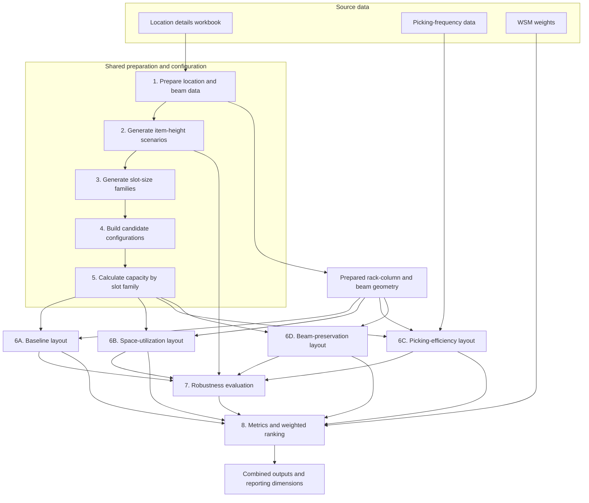

# Methodology of the Warehouse Slotting Model

## Model overview

This model develops and compares alternative storage-slot configurations for a warehouse. It begins with the existing location layout and item-height data, derives candidate slot-size families, and assigns those families to rack columns subject to the physical limits of the warehouse. The resulting layouts are then tested against alternative item-height scenarios and compared using a weighted-sum ranking.

The pipeline consists of eight stages. Stages 1 to 5 prepare the warehouse data and create a shared set of candidate configurations. Stage 6 generates a baseline layout and, when enabled, three alternative layouts that prioritize space utilization, picking efficiency, or beam preservation. Stages 7 and 8 evaluate and rank the feasible layouts. This structure allows the layout objectives to be compared while keeping the upstream candidate configurations and physical constraints consistent.

## Data flow



The first five stages are shared. The layout-generation stage then branches into the four methods. All layouts are assessed against the same Stage 2 scenarios, and the results are brought together for reporting. The ordered execution and optional method flags are defined in `Scripts/Pipeline/run_ordered_pipeline.py`.

## Source data and assumptions

The principal source is `Input files/Locations/Location details.xlsx`. It contains the location identifiers, rack, column and row coordinates, location types, location heights, item heights, and occupancy statuses used to describe the current warehouse. The picking-efficiency method also reads `Input files/Locations/Most frequently picked items heights 24-9 good.csv`, which provides item heights and assembly pick counts. Stage 8 reads `Input files/WSM_Weights.csv` for the directions and weights used in the weighted-sum method. Other SKU spreadsheets are present in the input directory but are not read by the active ordered pipeline.

The shared physical model assumes a column height of 770 cm and a beam height of 16 cm, leaving 754 cm for slots and their intervening beams. Representative slot sizes must end in 4 or 9. The shared maximum representative size is derived from the largest value in the Stage 3 summary; it is currently 239 cm. Beam-preservation matching uses an exact-height tolerance of 0 cm. Stage 1 also includes explicit beam-coordinate corrections for known exceptions in the current warehouse layout.

## Stage 1: Data preparation

Stage 1 reads the first worksheet in `Location details.xlsx`, checks that `Location`, `Location height`, and `Item height` are present, and calculates the clearance value `Delta` as location height minus item height. It retains the rack, column, row, location-type, and occupancy-status information because later stages need both the location records and the warehouse geometry.

The stage reconstructs the beam and grid arrangement by grouping locations by rack and column. General beam mappings are supplemented by explicit overrides for known exceptions. It writes the cleaned location records to `Output/01_Data_Preparation/Location_Details_Prepared.csv`, the location-to-beam mapping to `Output/01_Data_Preparation/Location_Beam_Map.csv`, and beam coordinates and height ranges to `Output/01_Data_Preparation/Beam_Height_Coordinates.csv`. It also writes `Output/01_Data_Preparation/Current_Layout_Space_Utilization.csv`, which summarizes occupancy and space use for each status snapshot in the workbook. The prepared locations and beam maps later define the assignment space and the beam changes required by candidate layouts. The utilization summary describes the existing warehouse; it is not the objective used to generate candidate layouts.

## Stage 2: Item-height scenarios

Stage 2 uses the prepared location data to represent uncertainty in future item heights. Zero-height items and rows whose location type is `layout` are excluded. Scenario 1 records the current item height. Locations with less than 5 cm of `Delta`, together with a predefined set of fixed locations, retain their current height in all six scenarios.

For other locations, Scenarios 2 to 5 apply 20%, 40%, 60%, and 80% of `Delta` to the current item height. An increase is accepted only while at least 5 cm of location clearance remains; if the next increase would violate this condition, the scenario retains the previous feasible height. Scenario 6 instead sets the item height to location height minus 5 cm without applying the ratchet rule. The six scenario values are written to `Output/02_Scenario_Generation/02_Item_Height_Scenarios_Delta_Weighted.csv`. Stage 3 uses them to develop scenario-specific slot-size families, while Stage 7 uses them to test layout robustness.

For an eligible location $i$, let $h_i$ denote its current item height, $H_i$ its location height, and $\Delta_i=H_i-h_i$. The candidate height in Scenarios 2 to 5 is $h_i+\alpha\Delta_i$, where $\alpha$ takes the values 0.2, 0.4, 0.6, and 0.8. The clearance rule is applied sequentially; if an increase would leave less than 5 cm, that scenario retains the preceding feasible height. Scenario 6 is calculated separately as $H_i-5$ cm.

## Stage 3: Slot-size generation

Stage 3 processes each scenario separately and groups its item heights into between one and ten families, where `K` denotes the number of families. Three methods are compared. Quantile binning creates approximately equal-sized groups while avoiding unnecessary cuts between repeated values. Hierarchical clustering merges adjacent groups according to Ward merge costs. K-means partitions the sorted height distribution around initialized centroids.

For each cluster, the model records the lower and upper observed item heights. The representative slot size is based on the upper bound plus 10 cm of clearance, rounded upward to an allowed 4-or-9 ending and capped at 239 cm. The pooled results are written to `Output/03_Slot_Size_Generation/Stage3_Slot_Size_Configuration_Summary_All.csv`. This file describes proposed slot families across the three methods, six scenarios, and tested values of `K`; it does not yet contain physical layouts.

If $u_c$ is the upper item-height bound for cluster $c$, the representative size is the smallest permitted 4-or-9-ending size at least $u_c+10$ cm, subject to the 239 cm cap. The clearance is added before Stage 4 checks whether the resulting family can form a physical rack-column profile.

## Stage 4: Candidate configurations

Stage 4 converts the Stage 3 proposals into configurations that can be tested as physical layouts. It groups the cluster records by clustering method, scenario, and `K`. When multiple clusters map to the same physical slot size, they are combined into one family and their relative shares are recalculated. Each resulting family is then screened against the physical stack rules, including legal slot sizes and the ability to complete a rack column within its height limit. Configurations that fail this check are excluded.

The accepted configurations are written to `Output/04_Candidate_Configuration/Candidate_Configurations.csv`. Each record identifies its `Config_ID`, source method and scenario, `K`, unique slot-size family, and relative share of each family. The current dataset contains 162 accepted configurations.

The family share is recomputed from the original cluster counts after duplicate sizes are merged, so the configuration still represents the source scenario's distribution. The physical screen tests whether the family contains a valid lower-slot stack that can be completed by a legal top slot; it removes families that cannot meet the column-height rules before capacity requirements are calculated.

## Stage 5: Capacity determination

Stage 5 translates each candidate's relative slot-size distribution into integer capacity requirements. The occupied-demand target is calculated as the arithmetic mean of the `Occupied_Locations` values in `Current_Layout_Space_Utilization.csv`, rounded upward to a whole location. The current file gives a target of 926. This target is allocated across the configured families using a largest-remainder method, which ensures that the family counts sum exactly to the target. The per-family counts are encoded in `Exact_Count_Distribution`, while `Required_Locations_Total` records the total.

For family share $p_k$, the initial allocation is $926p_k$. The model first assigns $\lfloor 926p_k\rfloor$ locations to each family, then distributes the remaining locations to the families with the largest fractional remainders. This converts the proportions to integer requirements without changing the total target.

The compact results are written to `Output/05_Capacity_Determination/Capacity_Determination_Summary.csv`. Stage 6 reconstructs its exact family requirements from this summary. The former detailed constraint-count file is no longer produced.

## Stage 6: Physical layout generation

Stage 6 combines the candidate configurations and exact family counts from Stages 4 and 5 with the prepared locations and beam maps from Stage 1. For each configuration, the baseline generator constructs legal slot profiles for the available rack columns. A profile must fit within the usable column height, account for the beam gaps, use allowed slot sizes, and satisfy the top-slot completion rules. The assignment process checks the exact family requirements and overall occupied-location target, after which the completed layout is checked for physical feasibility.

For a rack-column profile with $n$ slots of heights $h_1,\ldots,h_n$, the physical height is $\sum_{j=1}^{n}h_j+16(n-1)$ cm. A full-height profile must equal the 754 cm usable column height. The profile generator searches legal lower-slot combinations and calculates the residual height for the top slot; the top slot must satisfy the configured top-fill rules. It then removes profiles that have the same effective contribution to the configured slot-family counts. The baseline assignment uses deficit coverage to distribute the remaining family requirements across rack columns, accounting for the fact that one selected profile is repeated across the columns of a rack.

**Baseline**

The baseline method starts with the demand for each slot family and a set of rack-column profiles that can physically fit. It fills the racks by looking at which family requirements remain unmet: a profile is useful when it covers more of that remaining demand. Columns in the same rack share a profile, so choosing a profile for one rack means applying it across that rack's columns. The completed layout must still meet the required family counts and occupied-location target.

Once candidates have been built, feasible layouts are preferred first. Among them, the baseline comparison favors fewer beam relocations, then fewer additional beams, and then less space left unused. This is a preference among candidates, not permission to keep a layout that violates the physical or capacity rules.

**Space Utilization (SU)**

SU takes a feasible assignment as its starting point and asks whether a different profile could make better use of the rack space. It considers profile changes one rack at a time and keeps a change only when it increases the total slot space without causing any required slot family to fall short. It repeats this search while useful swaps remain or the search budget is reached. When a final top slot completes a configured family, its space is credited to that family rather than treated as a separate demand type.

**Picking Efficiency (PE)**

PE starts by looking at the picking-frequency file. Each item is associated with the smallest configured slot family that is tall enough to hold it; items that fit no family are recorded as uncovered. The method then treats a rack profile like a set of possible placements: picks assigned to a family contribute more when that family appears in a lower, easier-to-reach row, and less when it appears higher up.

PE compares combinations of profiles across racks, seeking high picking scores while still meeting the required slot-family counts. In other words, it tries to bring frequently picked items closer to the floor without changing how many locations of each family the layout must provide.

**Beam Preservation (BP)**

BP begins with the baseline assignment, then tests alternative rack profiles against the beam heights already present in the warehouse. For each proposed profile, it estimates where the beams would sit and checks whether those levels match the existing ones; the current tolerance is zero, so a match must be exact. This makes the search favor profiles that reuse existing beam positions and avoid added or moved beams.

BP keeps an alternative only if the completed assignment has fewer total beam relocations than the baseline. If no candidate achieves that strict improvement, it keeps the baseline assignment. Thus, beam preservation can improve the choice among feasible layouts, but it does not relax the shared slot-family or physical constraints.

Each method writes a candidate summary, location assignments, rack-column details, rack summaries, generated legal profiles, and empty-location counts by slot family. These outputs are named `Candidate_Layout_Summary.csv`, `Candidate_Layout_By_Location.csv`, `Candidate_Layout_By_Rack_Column.csv`, `Candidate_Layout_By_Rack.csv`, `Generated_Profiles_By_Config.csv`, and `Empty_Locations_By_Slot_Size.csv`. Variant files carry `_SU`, `_PE`, or `_BP` suffixes in their method-specific output folders. In the current run, each method has 162 Stage 6 candidate summaries. Infeasible candidates remain available for diagnostics, but only feasible candidates continue to Stages 7 and 8.

## Stage 7: Robustness evaluation

Stage 7 evaluates each Stage 6-feasible layout against the six item-height scenarios from Stage 2. For every scenario, the item-height distribution is rescaled to the derived occupied-demand target without changing its shape. Capacity is checked from larger heights downward: at each threshold, the number of items at least that tall must not exceed the number of assigned slots at least that large. This reflects that a taller slot can hold a shorter item when the shorter family's slots are full, whereas a shorter slot cannot hold a taller item.

For scenario $s$ and height threshold $t$, let $D_s(\ge t)$ be the normalized number of items at least that tall, and let $C_L(\ge t)$ be the number of slots in layout $L$ at least that large. The scenario passes for layout $L$ only when $D_s(\ge t)\le C_L(\ge t)$ for every threshold considered. The scenario's coverage ratio averages the capped capacity-to-demand ratios across the thresholds with positive demand.

A scenario passes only when all threshold checks pass. Robustness is calculated as the fraction of evaluated scenarios passed. Mean and worst scenario coverage ratios, together with failure details, are retained to describe partial robustness. The results are written to `Output/07_Robustness_Evaluation/Candidate_Layout_Robustness_Details.csv`. Robustness is included in the Stage 8 comparison, but a feasible layout is not excluded merely because its robustness score is below 1. The duplicate robustness summary and layout-exclusion reports are no longer produced.

## Stage 8: Metrics and weighted ranking

Stage 8 joins feasible Stage 6 layouts with the corresponding Stage 7 robustness results and calculates a scorecard for each candidate. To estimate occupied slot space, item demand is allocated to the smallest realized slot family that can contain it, with larger families available to absorb overflow where necessary. For each slot family, occupied space is calculated as slot height multiplied by the number of allocated items; total space uses the assigned slot count. Empty space is the difference between total and occupied space, utilization is occupied space divided by total space, and occupancy rate is occupied locations divided by total locations. The scorecard also includes beam and grid requirements, the number of unique slot sizes, and robustness. It describes the feasible candidates; the weighted-sum rank is the decision aid used to compare them.

For the weighted-sum method, metrics are normalized across the candidate set according to whether they should be minimized or maximized, multiplied by their specified weights, and summed. In the current `WSM_Weights.csv`, space utilization is minimized with weight 0.50, beam relocations are minimized with weight 0.25, and the number of unique slot sizes is minimized with weight 0.25. `Shared_Picking_Score` is included as a maximize-direction metric with weight 0; it is reported and normalized but does not affect the weighted score. The other zero-weight metrics also do not affect the score. Per-method WSM files rank candidates within each method. The combined WSM file recalculates normalization across the pooled Baseline, SU, PE, and BP candidates, allowing comparison across methods.

For a metric to maximize, its normalized value is the candidate value divided by the maximum value in the comparison set. For a metric to minimize, it is the minimum value divided by the candidate value. The weighted score is the sum of the normalized values multiplied by their weights. A zero reference value is handled separately in the implementation to avoid division by zero. The same calculation is first performed within each method; the combined WSM file then repeats normalization over the pooled four-method candidate set. Thus, a per-method rank compares candidates within that method, while a combined rank supports comparison across methods.

Stage 8 writes `Candidate_Layout_Metric_Ranking.csv` for candidate metrics and `Weighted_Sum_Method_Ranking.csv` for weighted scores and ranks. It also exports the physical assignments in `Final_Layout_By_Location.csv`, `Final_Layout_By_Rack_Column.csv`, and `Final_Layout_By_Rack.csv`. These files retain all feasible candidates used in the ranking rather than only the highest-ranked layout.

The implementation names the converted slot-space fields in cubic metres, but their underlying aggregate is a sum of slot heights multiplied by counts and divided by 100. Width and depth are not included in this calculation. The metric should therefore be interpreted as the model's slot-space proxy unless a fixed cross-sectional area is assumed separately.

## Interactions between stages

The model's stages are linked through a series of data handoffs. Stage 1 provides cleaned location heights, item heights, location types, and `Delta` to Stage 2, while its rack-column and beam geometry is reused in Stage 6. Stage 1 also calculates current-layout occupancy snapshots; their average occupied-location count, rounded upward, supplies the target used by Stages 5 through 7. Stage 2 passes six item-height distributions to Stage 3 and later supplies the scenario demand distributions used in Stage 7. Stage 3's cluster bounds, shares, representative slot sizes, method, scenario, and `K` are consolidated by Stage 4 into unique physical configurations.

Stage 5 translates each configuration's family shares into exact counts against the 926-location target. Stage 6 combines those requirements with available rack columns and beam geometry to construct physical assignments. Stage 7 compares each feasible assignment with the scenario demand distributions. Stage 8 joins the Stage 6 layout metrics and Stage 7 robustness measures to create candidate scorecards and weighted rankings. The final combiner adds method labels, configuration identifiers, and layout keys so the outputs can be compared across methods in reporting tools.

## Reporting outputs and current run

The baseline run writes combined files as each stage completes. When optional heuristics are enabled, `combine_heuristic_outputs.py` refreshes the combined Stage 6, 7, and 8 tables after all methods finish. It adds `Heuristic`, `Config_ID`, and layout-key columns and writes `Dim_Heuristic.csv` and `Dim_Config.csv` for reporting relationships.

For the current generated dataset, each method produced 162 Stage 6 candidates and 138 Stage 6-feasible candidates. The combined Stage 6 summary therefore contains 648 rows, while the combined Stage 7 details and Stage 8 rankings contain 552 rows each. These counts describe this input run and may change if the source workbook or model settings change.

The full set of methods can be run from the repository root with:

```powershell
python Scripts/Pipeline/run_ordered_pipeline.py --include-space-utilization --include-picking-efficiency --include-beam-preservation
```

## Implementation considerations

The occupied-location target is derived from the current-layout summary rather than stored as a literal in the shared pipeline. Its current value is 926, while the scenario CSV contains 939 eligible rows; Stages 5 and 7 rescale scenario demand to the derived target, so these counts describe different populations. Stage 2 contains a local 890 constant, but it is not used in the active scenario-generation calculation. The maximum representative slot size is likewise refreshed from the Stage 3 summary; its current value is 239 cm.

The 16 cm beam spacing and 754 cm usable column height are physical profile constraints. Stage 1 also contains explicit beam-point corrections based on warehouse layout notes, which should be revisited if the physical layout changes. Finally, the picking-efficiency objective depends on the separate frequency file, so changing that file can change PE scores and layouts without changing the location workbook.
